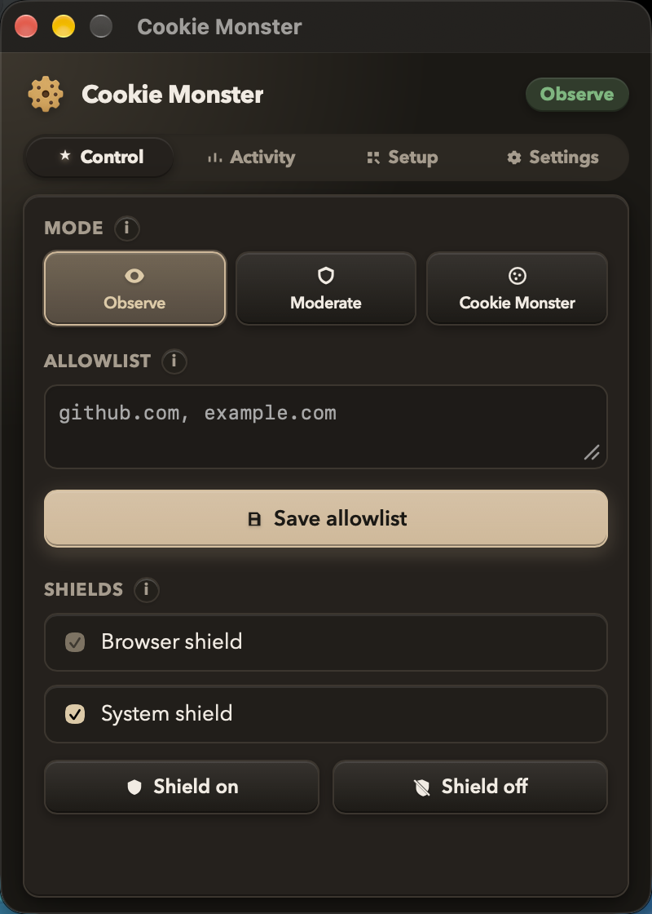
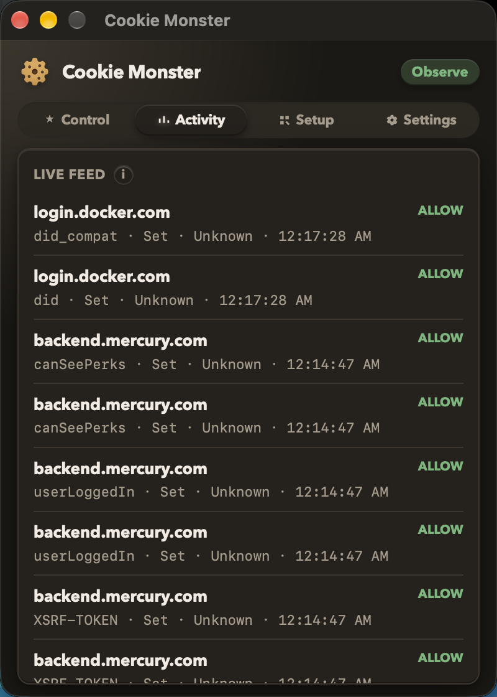
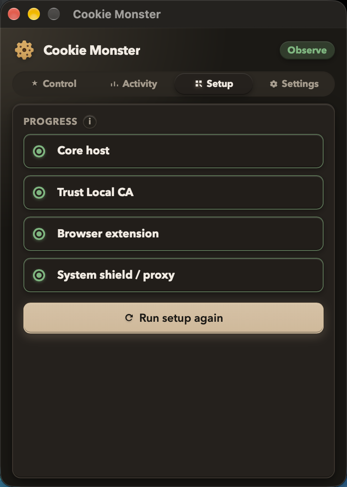
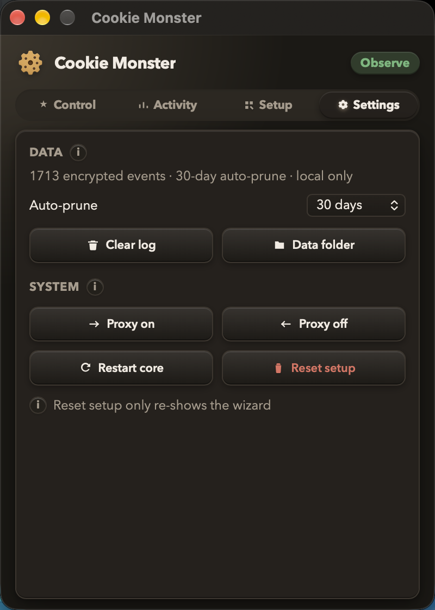

# Cookie Monster

**See every cookie. Control them locally. Nothing leaves your machine.**

Cookie Monster is a desktop-first cookie shield: a menu-bar app, browser extensions, and an optional system proxy — with encrypted logs, modes that actually decide, and zero cloud.

<p align="center">
  
</p>

| Mode | What it does |
|------|----------------|
| **Observe** | Watch Set/Send — log only, never blocks |
| **Moderate** | Keep Necessary (+ first-party Preferences); allowlist the rest |
| **Cookie Monster** | Deny sets / strip sends by default |

## Why get it

- **Local-only** — decisions and logs stay on-device; cookie *values* are never stored in plaintext
- **Two layers** — browser shield (Chromium/Firefox) + optional system shield (HTTP/HTTPS via local MITM)
- **Four panels** — Control · Activity · Setup · Settings (single-row tabs)
- **Hardened store** — AES-GCM encrypted SQLite, configurable retention, 50k event cap, owner-only keys/DB
- **Self-healing** — desktop restarts the core if it drops; logs rotate so disk doesn’t fill

<p align="center">
  
  &nbsp;
  
  &nbsp;
  
</p>

Screenshots are real captures from the running macOS app (not mockups).

## App panels

| Tab | What you get |
|-----|----------------|
| **Control** | Mode, allowlist, browser/system shields |
| **Activity** | Live redacted Set/Send feed — search, filter, sort, clear |
| **Setup** | Progress checklist + re-run wizard |
| **Settings** | Retention (7/14/30/90 days), clear log, open data folder, proxy on/off, restart core, reset wizard |

Info (`i`) tips explain each section — no long footnotes in the panel.

## What it can do

| Capability | Details |
|------------|---------|
| Browser shield | Chromium + Firefox extensions → native host |
| System shield | Local proxy `127.0.0.1:8877`, HTTPS with Local CA |
| Tray + Dock | White menu-bar template icon; always-on-top panel |
| Setup | First-run wizard; saved locally; survives updates |
| Settings | Retention, clear activity, proxy, restart core, reset setup |
| Native messaging | `scripts/install_native_messaging.sh` (macOS + Linux; Windows manual) |
| Safari | Web Extension scaffold + converter script |

## Where your data lives

All under the OS app-data directory (never the repo) via `directories::ProjectDirs`:

| Item | Purpose | Protection |
|------|---------|------------|
| `store.key` | AES-256 key | owner-only, created once |
| `events.db` | Encrypted event log | AES-GCM, prune + cap |
| `policy.json` | Mode / allowlist / shield / retention | owner-only |
| `ipc.token` | Desktop ↔ host auth | Rotated, owner-only |
| `local-ca/` | System-shield CA | Key owner-only |
| `setup.json` | Wizard progress | Survives updates, owner-only |

Nothing is uploaded. There is no account and no telemetry.

## Prerequisites

- [Rust](https://rustup.rs/) (stable) + Cargo
- Node.js 18+ (extensions + desktop frontend tooling)
- Python 3 (tests / fixture server)
- On Windows: [WebView2](https://developer.microsoft.com/microsoft-edge/webview2/) (Tauri bootstrapper can install it)

## Clone & build

```sh
git clone https://github.com/ojs393/CookieMonster.git
cd CookieMonster
cargo build -p cookie-monster-core --bin cookie-monster-native-host --release
npm --prefix extensions/chromium install && npm --prefix extensions/chromium run build
npm --prefix apps/desktop install
```

Lockfiles (`Cargo.lock`, `package-lock.json`) are committed on purpose — keep them for reproducible builds.

**macOS install** (release `.app` → `/Applications` + Desktop):

```sh
./scripts/macos_install_app.sh
```

**Dev** — host auto-starts with the UI:

```sh
npm --prefix apps/desktop run dev
```

**Chromium native messaging** (macOS/Linux; after loading the unpacked extension):

```sh
COOKIE_MONSTER_EXTENSION_ID=<id-from-chrome://extensions> ./scripts/install_native_messaging.sh chrome
```

**Firefox** (macOS/Linux; temporary add-on loaded — no extension id env needed):

```sh
./scripts/install_native_messaging.sh firefox
```

Optional: `COOKIE_MONSTER_ROOT=/path/to/repo` if you need to point at a source tree for extensions/dev binaries.

## System shield (optional)

1. Trust Local CA (setup wizard, or OS script below)
2. Enable **System shield** on Control
3. Route traffic (Settings → Turn proxy on, or OS script below)

| OS | Trust CA | Set / clear proxy |
|----|----------|-------------------|
| macOS | `scripts/macos_install_ca.sh` | `scripts/macos_set_system_proxy.sh` / `macos_clear_system_proxy.sh` |
| Windows | `scripts/windows_install_ca.ps1` | `scripts/windows_set_system_proxy.ps1 on\|off` |
| Linux | `scripts/linux_install_ca.sh` | `scripts/linux_set_system_proxy.sh on\|off` (GNOME → KDE → env file) |

The desktop UI calls the same helpers via `set_system_proxy` / `install_local_ca`.
Cert-pinned apps may bypass the proxy; that’s expected.

## Safari

```sh
./scripts/build_safari_extension.sh
COOKIE_MONSTER_SAFARI_CONVERT=1 ./scripts/build_safari_extension.sh
```

See `extensions/safari/README.md` and `apps/safari-bridge/` for the Swift TCP bridge.

### macOS distribution / notarization

```sh
./scripts/macos_prepare_app_store.sh          # Safari wrapper + desktop build checklist
./scripts/macos_notarize_app.sh               # Developer ID sign + notarytool + staple
```

Details: `apps/safari-bridge/DISTRIBUTION.md`. Needs your Apple Team ID / signing identity (never commit secrets).

## Security posture

- Loopback IPC only (`127.0.0.1`) with per-session token
- Proxy binds loopback only
- Values redacted before encrypt-at-rest
- No hardcoded personal paths — portable via ProjectDirs + bundle-relative binaries
- Hourly maintenance: prune by retention, cap events, rotate host logs

## Tests

```sh
./scripts/run_all_tests.sh
```

Runs Rust workspace tests, Chromium extension tests, fixture server tests, desktop client tests, and TCP e2e smokes.

## Platforms

| Layer | macOS | Windows | Linux |
|-------|-------|---------|-------|
| Rust core + encrypted store | ✅ verified | ✅ builds | ✅ builds |
| Tauri desktop UI | ✅ verified | ✅ `msi` target | ✅ `deb` / `AppImage` |
| Browser extensions | ✅ Chromium/Firefox/Safari | ✅ Chromium/Firefox | ✅ Chromium/Firefox |
| Native-messaging / Safari bridge | ✅ | manual Chromium manifest | ✅ |
| System proxy / CA helpers | ✅ scripts + UI | ✅ PowerShell + UI | ✅ GNOME + KDE + env fallback |

macOS remains the most exercised path. Public CI (`test (ubuntu)`) is a required merge check.

## License

**Source-available dual license** (not OSI “open source”):

| Use | Terms |
|-----|--------|
| Personal, hobby, research, education, other noncommercial | [PolyForm Noncommercial 1.0.0](LICENSE) |
| Commercial / paid products & services | Separate paid license — see [COMMERCIAL.md](COMMERCIAL.md) |

Contributions welcome under [CONTRIBUTING.md](CONTRIBUTING.md); PRs need the [CLA](CLA.md).
Security reports: [SECURITY.md](SECURITY.md).

---

**Cookie Monster** — local cookie visibility and control. Eat the trackers. Keep the session.
